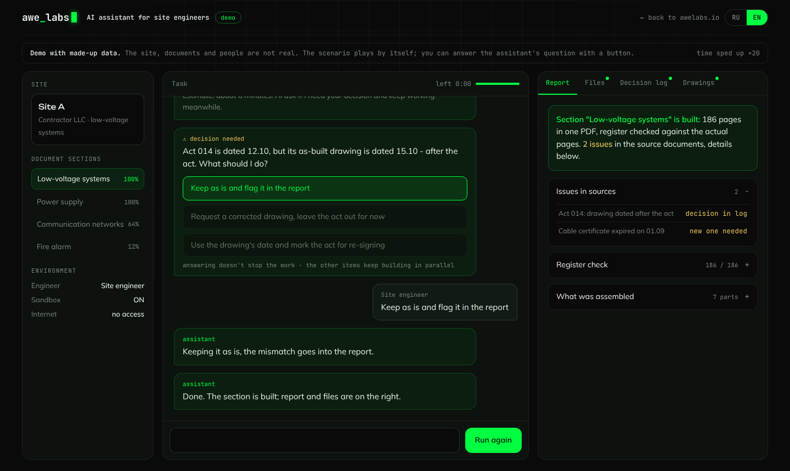
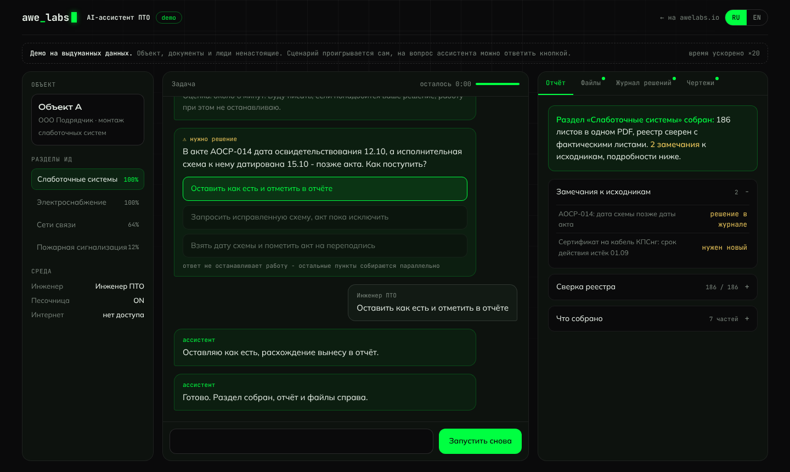

# AweLabs - AI assistant for site engineers (demo)

**Live demo:** https://awelabs.io/demo/asbuilt/

[English](#english) · [Русский](#русский)

## English

A front-end demo of a private web service that takes the routine out of **as-built documentation** on construction sites. The site engineer gives a task in plain words, as they would to a colleague, and the AI assistant assembles the document section, checks the register against the actual pages and asks only when the answer changes the document.

> This repository is a **demo on made-up data**. The site, documents and people are fictional. The production service code and real documents are not published.

### What the real service does
- **Builds full sections into one PDF** - title page, register, orders, inspection acts, drawings, test reports and quality documents. Page numbers in the register are checked against the actual pages.
- **AI assistant** - works with Excel and PDF, checks its own output visually. Errors found in source documents are listed and raised as questions, never silently "fixed".
- **Questions with buttons** - when a decision affects the document, the assistant asks with ready options and keeps working meanwhile. The engineer can refine the task mid-run without starting over.
- **Clear report** - a 2-3 line summary on top, details folded by section, open questions in plain sight.
- **AutoCAD drawings** - batch fixes of as-built drawings: title block fonts per standard, centred text, text width rules. PDFs are re-printed from the drawing, so every fix is in the PDF too.
- **Sync with the engineer's laptop** - finished sets land in a folder on the laptop, integrity checked by checksum. Any file or the whole folder can also be downloaded.
- **Project memory** - a decision log: which version to keep, who signs, what was issued. Agreements survive from task to task.
- **Timer** - shows how long a task will take and when it will be ready.

### Reliability and security
- The assistant runs in an isolated sandbox with no internet access and sees only the project folder.
- Source files are never overwritten: every output is a new version, deletions go to a recycle bin.
- If the server restarts mid-task, the assistant resumes from the same point.
- Role separation: the engineer sees their workspace; costs and technical details are visible to the admin only.

### Who it is for
General contractors and subcontractors whose site engineers are buried in as-built paperwork: low-voltage, electrical, utility networks.

### About the demo
- One static `index.html`, no build, no backend, no dependencies except Google Fonts.
- The scenario plays by itself; the assistant's question can be answered with a button (or a default is picked after a few seconds).
- RU / EN, time sped up ×20.

---

## Русский

Фронт-демо закрытого веб-сервиса, который снимает рутину с **исполнительной документации (ИД)** на стройке. Инженер ПТО ставит задачу обычными словами, как коллеге, а AI-ассистент собирает раздел, сверяет реестр с фактическими листами и спрашивает только тогда, когда от ответа зависит документ.

> Репозиторий - **демо на выдуманных данных**. Объект, документы и люди ненастоящие. Код рабочего сервиса и реальные документы не публикуются.

### Что умеет настоящий сервис
- **Собирает разделы ИД целиком** - титул, реестр, приказы, акты, схемы, протоколы и документы качества складываются в один PDF. Номера листов в реестре сверяются с фактическими страницами.
- **ИИ-помощник для инженера** - работает с Excel и PDF и сам проверяет результат глазами. Найденные ошибки в исходных документах не исправляет молча, а перечисляет и спрашивает, что делать.
- **Вопросы по ходу работы** - если от ответа зависит документ, помощник сразу показывает вопрос с готовыми вариантами-кнопками и не останавливает работу. Задачу можно уточнить прямо во время работы, начинать заново не нужно.
- **Понятный отчёт** - сверху итог в двух-трёх строках, подробности свёрнуты по разделам, вопросы на виду.
- **Чертежи в AutoCAD** - пакетная правка исполнительных схем: шрифты по ГОСТ, текст по центру штампа, ширина текста по правилам оформления. PDF печатается с чертежа, поэтому всё исправленное в чертеже есть и в PDF.
- **Обмен с рабочим ноутбуком** - готовые комплекты сами попадают в папку на ноутбуке инженера, целость проверяется по контрольной сумме. Любой файл или всю папку можно скачать.
- **Память проекта** - журнал решений: какую версию оставлять, кто подписывает, что выдано. Договорённости не теряются между задачами.
- **Таймер** - видно, сколько займёт задача и когда примерно будет готова.

### Надёжность и безопасность
- Помощник работает в изолированной песочнице без доступа в интернет и видит только рабочую папку проекта.
- Исходные файлы не перезаписываются: каждая выдача - отдельная версия, удалённое уходит в корзину.
- Если сервер перезапустился посреди работы, помощник продолжает с того же места.
- Разделение доступа: инженер видит свою рабочую область, расходы и технические детали - только администратор.

### Кому подходит
Генподрядчикам и субподрядчикам, у которых ПТО тонет в исполнительной документации: слаботочка, электрика, инженерные сети.

### О демо
- Один статичный `index.html`, без сборки и бэкенда.
- Сценарий проигрывается сам, на вопрос ассистента можно ответить кнопкой (иначе через несколько секунд выбирается вариант по умолчанию).
- RU / EN, время ускорено ×20.

---

**AweLabs** - automation studio · [awelabs.io](https://awelabs.io) · [t.me/awe_labs](https://t.me/awe_labs)
